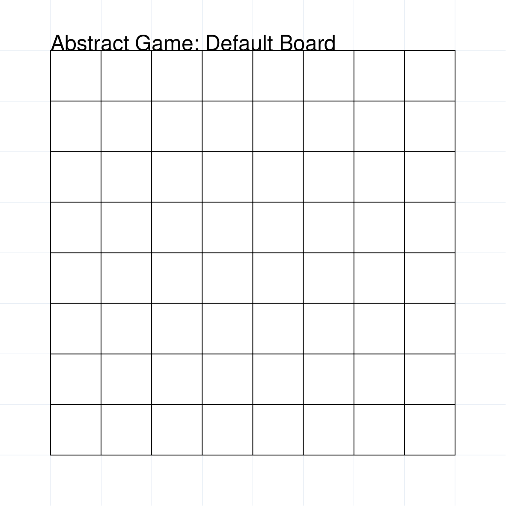
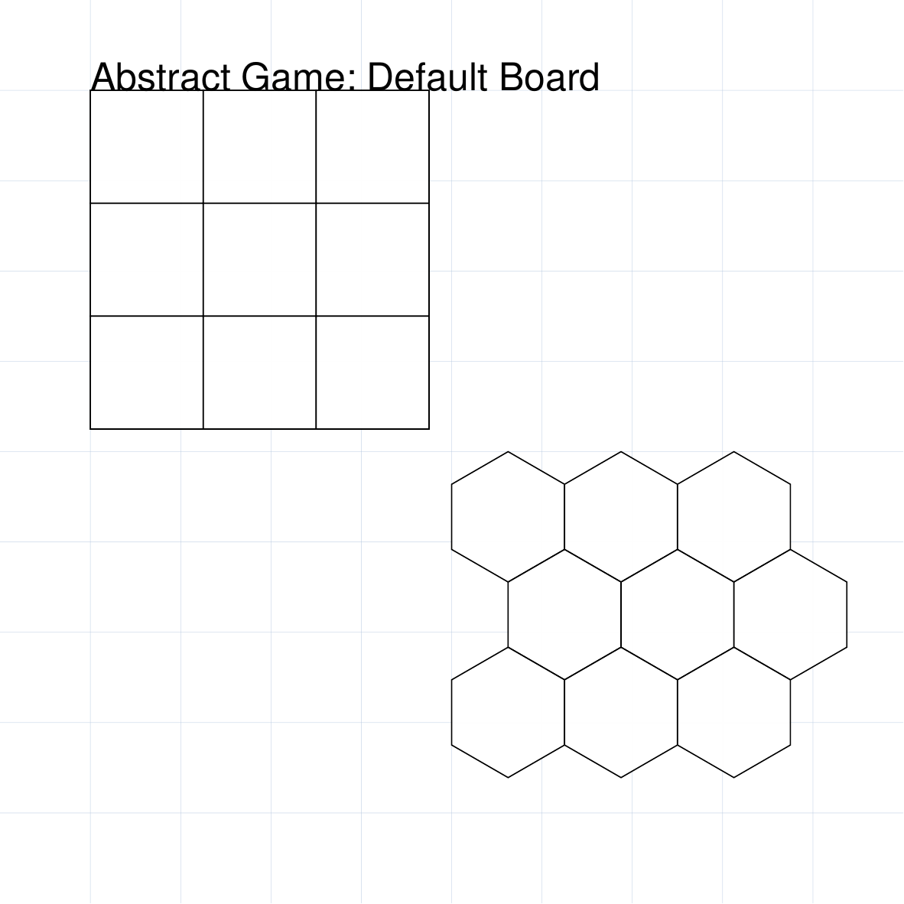
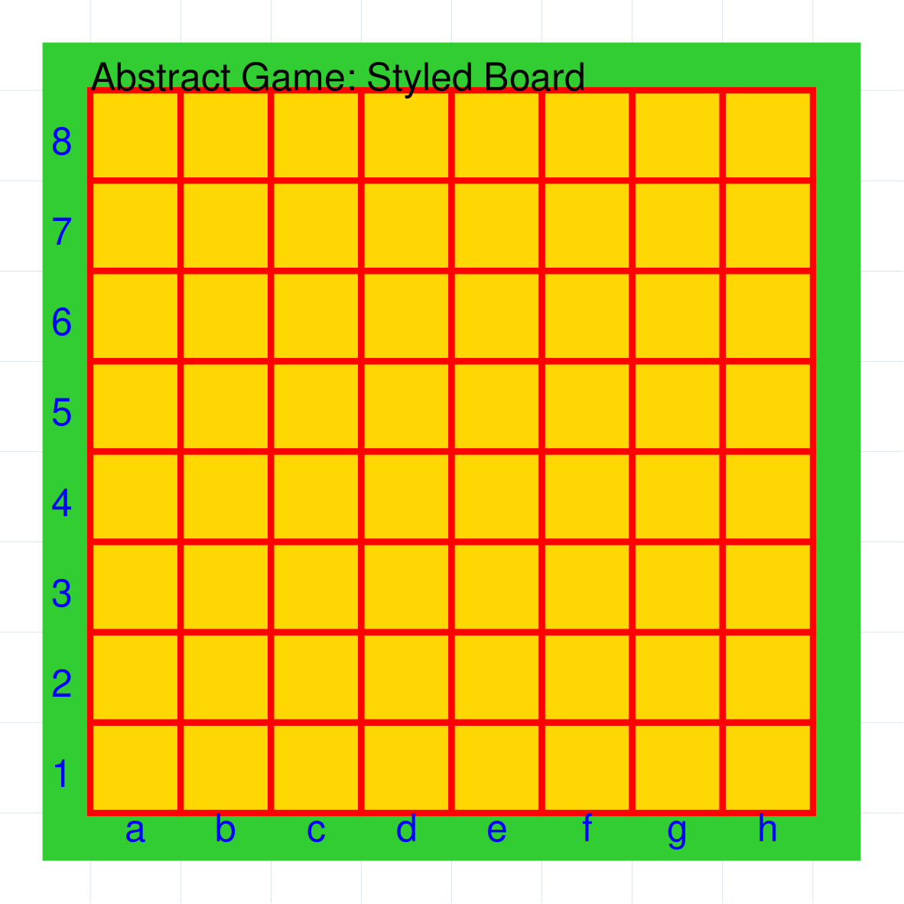
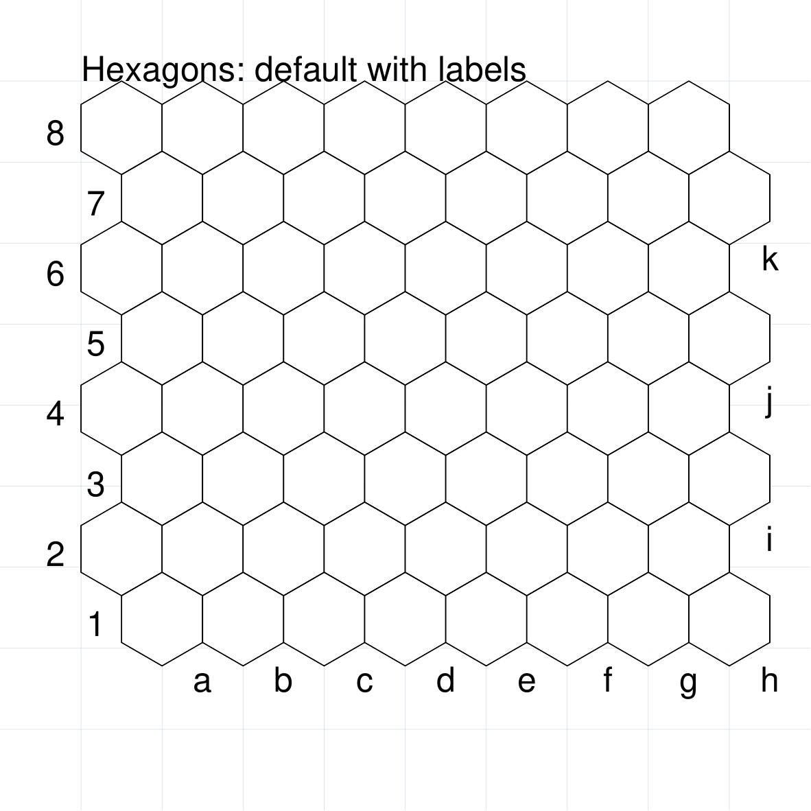
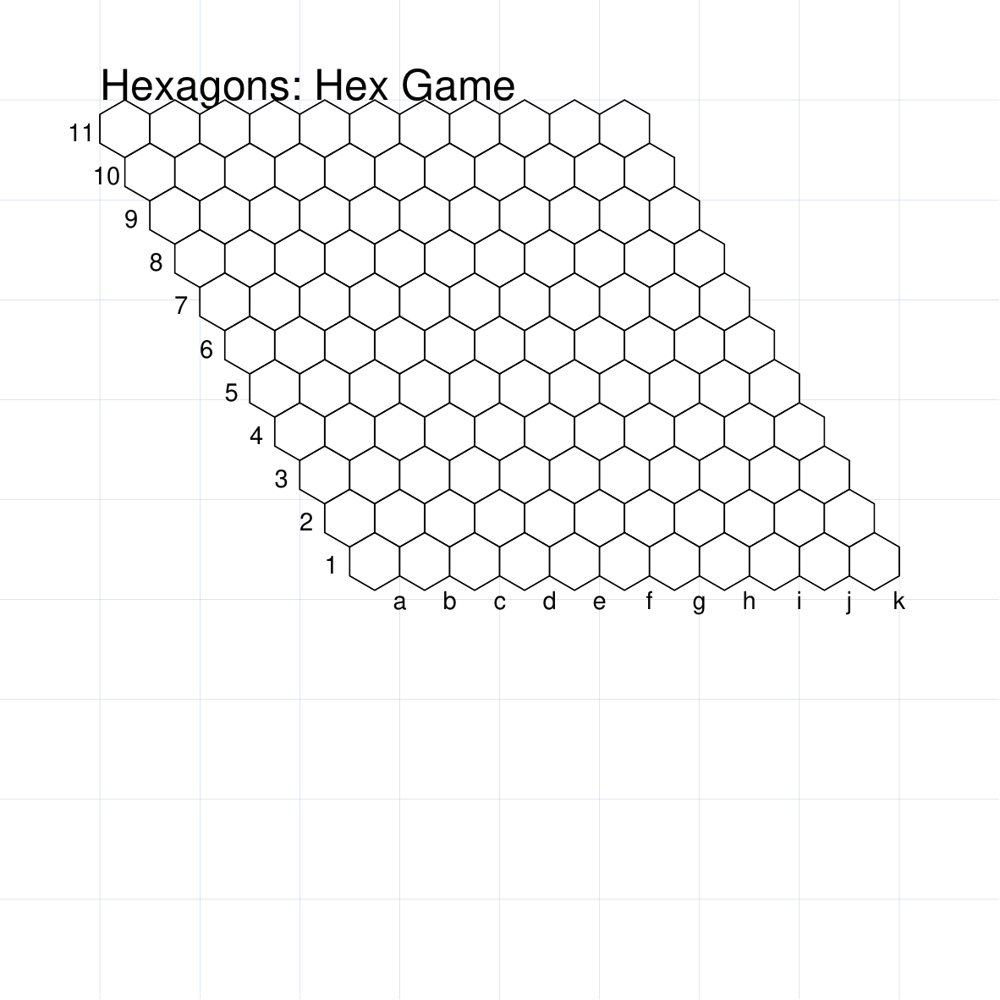
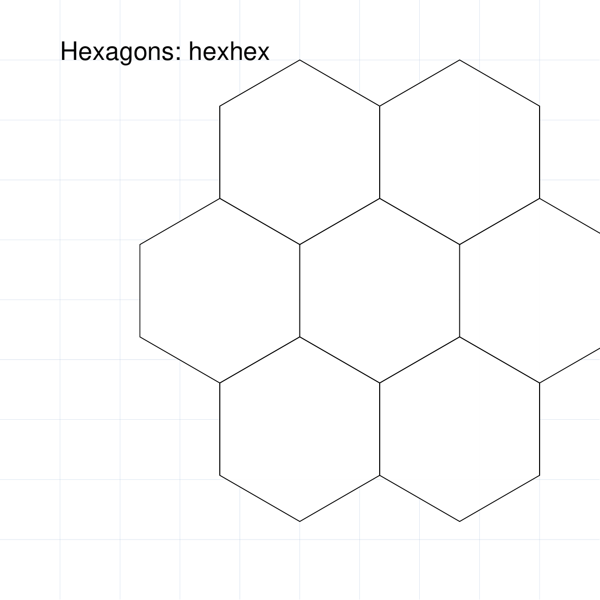
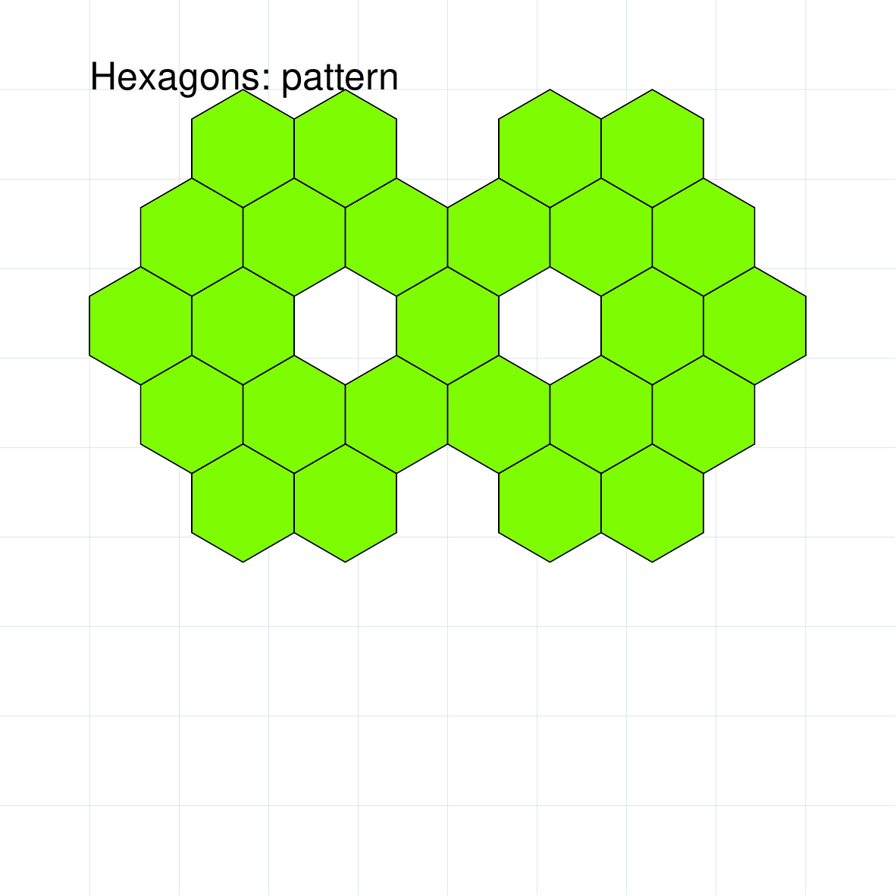
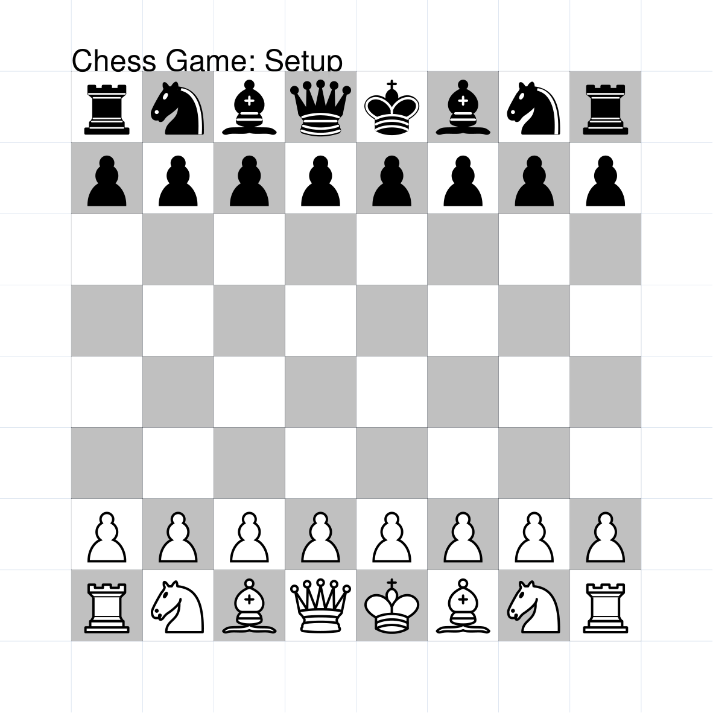
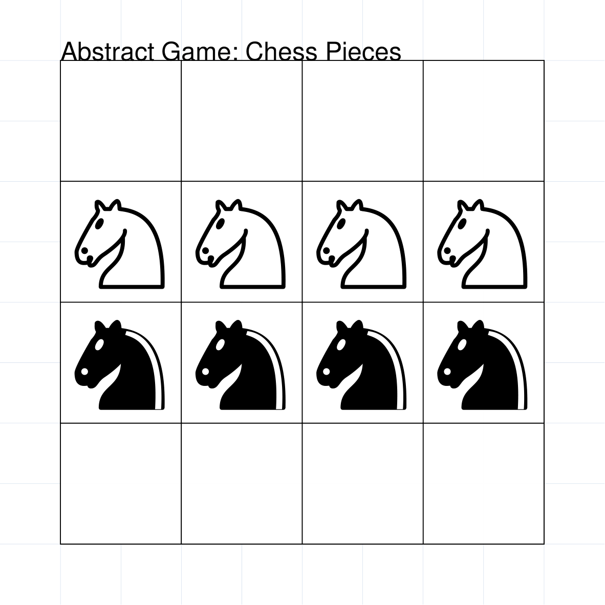
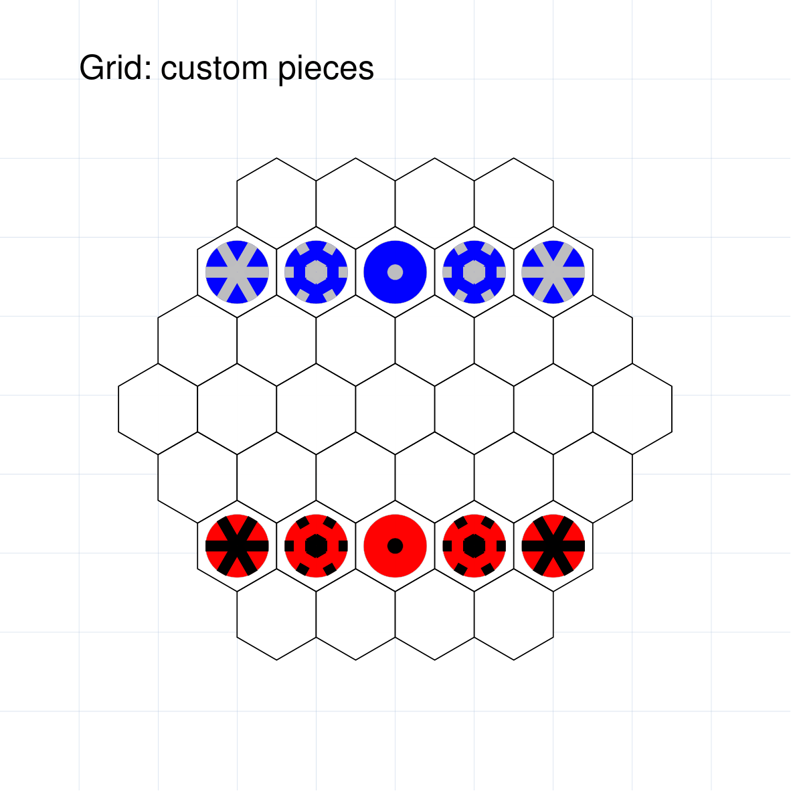

==============================
AbstractGame and AbstractState
==============================

.. |dash| unicode:: U+2014 .. EM DASH SIGN

The ``AbstractGame`` and ``AbstractState`` are two of a number of commands
used to create what are termed :doc:`Compound Objects <index>`.

This section assumes you are very familiar with the concepts, terms and ideas
for :doc:`protograf <../index>`  as presented in the
:doc:`Basic Concepts <../basic_concepts>` , that you understand all of the
:doc:`Additional Concepts <../additional_concepts>` and that you've created some
basic scripts of your own using the :doc:`Core Shapes <../core_shapes>`. You
should also be familiar with the various types of shapes' properties described in
the :doc:`Customised Shapes <../customised_shapes>`.

.. _abstractIndex:

- `Overview`_
- `AbstractGame Command`_
- `AbstractState Command`_
- `Abstract Resources`_

.. _abstractOver:

Overview
========
`↑ <abstractIndex_>`_

Abstract games are the ancestors of many modern games.  They continue to be
played and appreciated by gamers of all ages across many societies.
In addition, many new abstract games continue to be designed and tested.

The aim of the ``AbstractGame`` and ``AbstractState`` commands is to allow
diagrams for many of these types of games to be easily created.

The ``AbstractGame`` command allows for the details of the board and pieces
for such a game to be specified.  However, an ``AbstractGame`` is **not**
designed to be drawn |dash| it can be thought of as the game being
"still in the box".

The ``AbstractState`` command will, when supplied with a previously defined
``AbstractGame``, allow for a position in that game |dash| at any point from
the setup through to its end state |dash| to be shown in diagrammatic form
and also, optionally, annotated.

A series of ``AbstractState`` commands, all using the same ``AbstractGame``
command could, if required, depict an entire game but this is not the primary
intended use of the ``AbstractState`` command.

.. NOTE::

  An AbstractState command does **not** have the concept of a game "move".
  Tracking and processing moves is beyond the scope of **protograf**.
  The *markers* property for the AbstractState can be used to show
  how a piece might move with, for example, the aid of a line or arrow.


.. _abstractgame-command:

AbstractGame Command
====================
`↑ <abstractIndex_>`_

The ``AbstractGame()`` command defines the parts of an abstract game; primarily
the type, and styling, of the board and pieces that it uses.

There are two primary types of board:

- **grid** which is an array-like arrangement of square cells, and
- **hexagonal** which  an arrangement of hexagons.

For both type, the **size** of the board is usually set by a combination of
rows and columns.

A board can also be specified either by referring to an existing abstract game
by name |dash| for example, Chess, Checkers (aka Draughts), Go or Shogi.

Pieces can be specified by the type of game that they are usually used
with |dash| for example, Chess, Checkers (aka Draughts), Go or Shogi. It is
also possible to create completely unique pieces either by using one or more
of **protograf** shapes and/or images of your choice.

- `AbstractGame Properties`_
- `AbstractGame Board: Grid`_
- `AbstractGame Board: Hexagonal`_
- `AbstractGame Pieces`_

.. _abstractGameProperties:

AbstractGame Properties
-----------------------
`^ <abstractgame-command_>`_

The key properties that can be set for an AbstractGame are:

* *name*: the name of a type of board; which can chosen from  one of:
  ``chess``, ``checkers``, ``go``, ``shogi``, ``hex``, ``hexhex``,
  ``hexagonal``; if omitted, the default type is a ``grid``
* *pieces*: details of pieces that will be placed on the board; these
  pieces can:

  * make use of the full set available from a pre-defined game (``chess``,
    ``checkers``, ``go``, ``shogi``, ``shogi-int``) by using
    *pieces_type* property (see below); or
  * each be chosen individually and **independently** of the board name from
    any of the pre-existing sets: ``chess``, ``checkers``, ``go``,
    ``shogi``, ``shogi-int``; or
  * be defined with a customised list of piece names and shapes; see below
    for `AbstractGame Pieces`_
* *cols*: if no game *name* has been set, then this is the number of cells,
  in the horizontal direction, for a regular grid; a default of ``8`` is used
* *rows*: if no game *name* has been set, then this is the number of cells,
  in the vertical direction, for a regular grid; a default of ``8`` is used

Using the name of an existing game will also select the associated number of
rows and columns for that game; for example, a *Shogi* board has 9 rows and
9 columns.

.. IMPORTANT::

    Unlike many other shapes or objects in **protograf**, the *height* property
    is used to set the height of a cell on the board, and **not** the height
    of the board itself |dash| this being derived from the combination of
    the number of rows and columns as well the cell *height*.  The reason for
    this is to support both square and hexagonal cells with a single property.

    In the examples used, if *height* is **not** set, then its value is
    calculated by sizing the board to occupy as much of the page as possible.

Other useful properties that can be set for an AbstractGame are:

* *fills*: a list of one or more :ref:`colors <basic-color>` in which to draw
  one or more alternating board spaces; the default is to draw all cells
  ``white`` |dash| other cell properties can be set with the normal *stroke*
  and *stroke_width*
* *frame*: if ``True``, draw a frame around a gridded board's outlines; use the
  normal styling options to customize it |dash| *frame_width*, *frame_stroke*,
  *frame_fill*, *frame_dotted*, and/or *frame_dashed*
* *height*: sets the height of a single cell (the "edge-to-edge" distance for a
  hexagon)
* *hexes*: a value, only used for hexhex board, which sets the number of
  hexagons along each edge of the board; see `Example 2: Hex Game Grid`_
* *pattern*: an on/off design showing which cells should be blank i.e. unused
  |dash| see `Example 4: Pattern Grid`_ for how this works
* *intersections*: if ``True``, draw pieces on **grid intersections**, not
  grid spaces, and label the lines, not the spaces
* *label*: if ``True``, draw labels around the board's edges; use the
  normal styling options for a label; *label_font*, *label_stroke* etc.
* *label_type*: the type of label, drawn on the board edges, which is
  used to identify a row or column; it can be  either *alpha-numeric*,
  or ``AN`` (the default), which is the labelling used for Chess boards;
  or *numeric*, or ``NN``, which is the labelling used for Shogi boards
* *label_start*: the corner of the board at which the labelling starts; this
  can be: *bottom-left* (``BL``), *bottom-right* (``BR``), *top-left* (``TL``),
  or *top-right* (``TR``). Chess board labels start at the *bottom-left*
  |dash| which is the default |dash| while Shogi board labels start at the
  *top-right*.
* *label_offset*: how far away label are drawn from the board edge(s); if not
  set, this is calculated based on the label's font size
* *pieces_type*: choose a predefined set of pieces from various abstract
  games; possible choices are: ``chess``, ``checkers``, ``go``, ``shogi`` or
  ``shogi-int`` (International, or Westernised, Shogi)
* *pieces_resize*: a fractional value by which to resize the built-in piece
  shapes or images; this defaults to ``1`` |dash| note that this does **not**
  apply to custom-made shapes


.. NOTE::

    The default settings for an AbstractGame are:

    * *name*: ``grid``
    * *rows*: ``8`` (the same as Chess or Checkers board)
    * *cols*: ``8`` (the same as Chess or Checkers board)
    * *pieces*: ``checkers`` (simple black and white circles)

    A board is sized to occupy as much space as possible, unless the *height*
    of a cell is set, following which the space occupied by the board is
    calculated using the *rows* and *cols* values.

    Note also that the definitions of the board and pieces are **not**,
    generally speaking, the determinants of *where* the pieces get placed;
    how *many* pieces there are, or what the rules are for their movement!


.. _abstractGameGrid:

AbstractGame Board: Grid
------------------------
`^ <abstractgame-command_>`_

A basic AbstractGame board is just a grid of squares and, depending on the
game, will contain either an equal or unequal number of rows and columms.

Such a grid allows pieces to be placed either in the spaces between the lines
or on their intersection points |dash| **protograf** terms these locations
*cells*.

Below are some examples of gridded boards.  There are further examples in
the section on the `AbstractState Command`_.

Example 1: Default Board
~~~~~~~~~~~~~~~~~~~~~~~~



===== ======
|ab1| This example shows an ``AbstractBoard`` constructed using these commands:

      .. code:: python

         agd = AbstractGame()
         AbstractState(board=agd)

      The default settings for a board are those for a 8x8 grid of square cells.

      As can be seen, the board is drawn when it is referenced by the *board*
      property of an ``AbstractState`` command.  In short: the ``AbstractGame``
      is assigned to ``adg`` which in turn is referenced by ``board=agd``.

===== ======


Example 2: Board Size and Position
~~~~~~~~~~~~~~~~~~~~~~~~~~~~~~~~~~



===== ======
|ab2| This example shows ``AbstractBoard`` used with these commands:

      .. code:: python

        agsp = AbstractGame(
            x=0, y=0,
            height=1.25,
            rows=3, cols=3,
        )
        AbstractState(board=agsp)

        ahsp = AbstractGame(
            name="hexagons",
            x=4, y=4,
            height=1.25,
            rows=3, cols=3,
        )
        AbstractState(board=ahsp)

      Each of the two boards shown have their own *rows*, *cols* and *height*
      values set in order to determine their size.

      Each of the two boards shown make use of custom *x* and *y* values to
      set their position on the page.

      The board on the lower-right also has the *name* set to ``hexagons``
      in order to change its layou; more example of these types can be
      seen in :ref:`Hexagonal AbstractGame Boards <abstractGameHexagonal>`.

      As can be seen, the boards are drawn when referenced by the *board*
      property of the ``AbstractState`` commands (``agsp`` and ``ahsp``
      respectively).

===== ======


Example 3: Styled Board
~~~~~~~~~~~~~~~~~~~~~~~



===== ======
|ab3| This example shows an ``AbstractBoard`` constructed using these commands:

      .. code:: python

        ags = AbstractGame(
            name="grid",
            fills=["gold"],
            stroke="red",
            stroke_width=2,
            frame=True,
            frame_width=15,
            frame_stroke="limegreen",
            label=True,
            label_stroke="blue"
        )
        AbstractState(board=ags)

      The default board size is a 8x8 ``grid`` of square cells; in this
      example the type of board is explicitly set via its *name* property.

      In this case, the board is further styled by setting:

      - *fills* - a list one or more colors; in this case just a single one
      - *stroke* - the color of the grid lines
      - *stroke_width* - the thickness of the grid lines
      - *frame* - if ``True``, the frame will be drawn
      - *frame_width* - the thickness of the frame (in point units)
      - *frame_stroke* - the color of the frame
      - *label* - if ``True``, the labels will be drawn
      - *label_stroke* - the color of the labels

      The *label_start* defaults to the *bottom-left* (``BL``),
      and the *label_type* defaults to  *alpha-numeric* (``AN```); so
      letters for the columns go from left to right along the bottom edge
      and numbers for the rows increase from ``1`` up along the left edge.

      As can be seen, the board is drawn when it is referenced by the *board*
      property of an ``AbstractState`` command.

===== ======


.. _abstractGameHexagonal:

AbstractGame Board: Hexagonal
-----------------------------
`^ <abstractgame-command_>`_

A grid made up hexagons is used in a number of abstract games.  There are
different styles, or type of hexagonal grids, all referenced through the
board's *name* property.


Example 1: Rectangular Hexagonal Grid
~~~~~~~~~~~~~~~~~~~~~~~~~~~~~~~~~~~~~



===== ======
|ah1| This example shows an ``AbstractBoard`` constructed using these commands:

      .. code:: python

        aghd = AbstractGame(
            name="hexagons",
            label=True)
        AbstractState(board=aghd)

      The default hexagonal board size is a 8x8 arrangement of hexagonal
      cells in a "pointy" orientation.

      As shown, this type of board is  set via its *name* property to
      ``hexagons`` |dash| a *name* property of ``hexagonal`` can also be
      used.

      Setting ``label=True`` activates the default labellng; stating at the
      bottom-left of the grid, letters are assigned to the diagonally-sloping
      columns, and numbers to the rows.

===== ======


Example 2: Hex Game Grid
~~~~~~~~~~~~~~~~~~~~~~~~



===== ======
|ah2| This example shows an ``AbstractBoard`` constructed using these commands:

      .. code:: python

        aghd = AbstractGame(
            name="hex",
            label=True,
            label_size=7)
        AbstractState(board=aghd)

      In this example the type of board is set via its *name* property to
      ``hex``.

      This board appears as a rhombus shaped layout of 11 rows by 11 columns
      and is used for the game called **Hex**.

      The game of  **Hex**, was created by Piet Hein in 1942; see
      https://en.wikipedia.org/wiki/Hex_(board_game)

===== ======


Example 3: HexHex Grid
~~~~~~~~~~~~~~~~~~~~~~

The term "hexhex" refers to a hexagonal grid that itself appears to look like
a hexagon.

This type of board is constructed by:

1. Setting the *name* to ``hexhex``
2. Specifying the number of *hexes* that should appear along the edge or side
   of the hexagonal grid; the minimum |dash| and default |dash| *hexes* value
   being ``2``.

.. NOTE::

    The *rows* and *cols* properties used by other ``AbstractBoard``
    layouts are **not** applicable to a ``hexhex`` layout.



===== ======
|ah3| This example shows an ``AbstractBoard`` constructed using these commands:

      .. code:: python

        aghh = AbstractGame(
            name="hexhex",
            hexes=4)
        AbstractState(board=aghh)

      In this example the type of board is set via its *name* property to
      ``hexhex``.

      The *hexes* property is set to ``4`` |dash| this results in a grid with
      7 rows; and 7 columns in the centre row.

===== ======

Example 4: Pattern Grid
~~~~~~~~~~~~~~~~~~~~~~~

If a hexagonal grid for a game contains a custom number of hexagons,
that may vary across the rows of the board, then a pattern design,
or layout, can be defined for the ``AbstractGame``.

A pattern grid uses a cell-and-dot notation which is set with the
*pattern* property.

This notation represents each row as separate line, with each regular, or
normal hexagon with a ``O`` (the letter "oh"), and each blank, or missing,
cell with a ``.`` (dot or full stop).

There should be as many lines in the pattern as are set in the *rows* value
for the ``AbstractGame``. Similarly, the total combined number of hexagons
and blanks, in any given line, must match the *cols* value.

The best way to represent multi-line list of characters such as this is by
starting and ending the pattern definition with triple quotes |dash| ``"""``.

Note that empty lines and "whitespace" at the start and end of a pattern will
be ignored; as is any whitespace on a line.

If a row on the board contains only hexagons, this can be shown with a
single ``O``.




===== ======
|ah4| This example shows an ``AbstractBoard`` constructed using these commands:

      .. code:: python

        aghp = AbstractGame(
            name="hexagons",
            rows=5,
            cols=7,
            pattern = """
            . O O . O O .
             O O O O O O .
            O O . O . O O
             O O O O O O .
            . O O . O O .
            """)
        AbstractState(board=aghp)

      In this example the type of board is set via its *name* property to
      ``hexagons``.

      The *pattern* property shows, in string format, an arrangement of
      hexagons (``O``) and spaces (``.``).

      Note that the spaces in the pattern are ignored when constructing the
      board; they are just used to help visualise the pattern being created.

      .. NOTE::

          It is important that the correct number of *rows* and *cols* are
          set; the pattern has to fit exactly in these dimensions.

===== ======


.. _abstractGamePieces:

AbstractGame Pieces
-------------------
`^ <abstractgame-command_>`_

*protograf's* library includes pieces from well-known games available as
SVG images sourced from the internet. These can be used as a set or as
individually referenced pieces.

You can also define your own set of shapes to be used with a game.

Built-in pieces for a known game
~~~~~~~~~~~~~~~~~~~~~~~~~~~~~~~~

If you have chosen an existing "named" game, the default set of pieces
corresponding to that game will automatically be selected.



===== ======
|ap1| This example shows an ``AbstractBoard`` constructed using these commands:

      .. code:: python

        agcs = AbstractGame(
            name="chess")
        AbstractState(
            board=agcs,
            setup=True)

      In this example the type of board is set via its *name* property to
      ``chess``.  This results in the default grid with alternating colored
      squares.

      Because of the use of ``setup=True`` in the ``AbstractState``, the
      built-in Chess pieces are displayed in their starting positions.

===== ======


Reusing built-in pieces for a game
~~~~~~~~~~~~~~~~~~~~~~~~~~~~~~~~~~

It is possible to select a piece, or pieces, from any of the built-in games.

This is done by using a ``game_color_piece`` notation; for example, the White
King from Chess is referenced by ``chess_white_king``.



===== ======
|ap2| This example shows an ``AbstractBoard`` constructed using these commands:

      .. code:: python

        knights = [
            ('K', 'chess_white_knight'),
            ('J', 'chess_black_knight')]
        agcp = AbstractGame(default=thick,
            rows=4, cols=4,
            pieces=knights,
            )
        AbstractState(
            board=agcp,
            positions="""
            .
            KKKK
            JJJJ
            .
            """)

      In this example the type of board is set via its *name* property to
      ``grid`` of size 4 rows by 4 columns.

      The ``knights`` value is assigned to a list of pieces; with each letter
      |dash| one that you choose to represent the pieces for the purpose of
      displaying it on the board |dash| is paired with an existing piece;
      in this case the Knights from Chess.

      The use of the *positions* property is described in
      :ref:`AbstractState Positions <abstractStatePositions>`.

===== ======

Defining custom pieces
~~~~~~~~~~~~~~~~~~~~~~

Custom pieces can either be designed with **protograf**'s built-in shapes,
or by referencing a pre-created image.

.. NOTE::

    If you use an image for a shape, ensure that it is square so as to fit
    properly into a standard grid cell |dash| square or hexagon.



===== ======
|ap3| This example shows an ``AbstractBoard`` constructed using these commands:

      .. code:: python

        red_pieces = Common(
            radius=0.4, fill="red",
            radii_stroke_width=4,
            radii_stroke="black",
            dot_stroke="black")
        blu_pieces = Common(
            radius=0.4, fill="blue",
            radii_stroke_width=4,
            radii_stroke="silver",
            dot_stroke="silver")
        angles = [60, 120, 180, 240, 300, 360]

        RA = circle(common=red_pieces,
                    radii=angles,
                    radii_dotted=True)
        RL = circle(common=red_pieces,
                    radii=angles)
        RC = circle(common=red_pieces,
                    dot=0.1)

        BA = circle(common=blu_pieces,
                    radii=angles, radii_dotted=True)
        BL = circle(common=blu_pieces,
                    radii=angles)
        BC = circle(common=blu_pieces,
                    dot=0.1)

        all_pieces = [
            ('A', RA), ('L', RL), ('C', RC),
            ('a', BA), ('l', BL), ('c', BC),
        ]

        agpi = AbstractGame(default=thick,
            name="hexhex",
            y=1,
            height=1,
            hexes=4,
            pieces=all_pieces)
        AbstractState(
            board=agpi,
            positions="4/lacal/6/7/6/LACAL/4"
        )

      In this example the type of board is set via its *name* property to
      ``hexhex``, with 4 *hexes* per side.

      The board's *pieces* property is set to the name ``all_pieces``.  This
      in turn is assigned to a list of paired values:  a letter and another
      name, for example, ``('L', RL)``.

      The ``RL`` in turn is defined by a Circle shape, with various properties
      creating the red circle piece with six black lines drawn through it.

      The use of the *positions* property to display these pieces on the
      board is described in
      :ref:`AbstractState Positions <abstractStatePositions>`.

===== ======


.. _abstractstate-command:

AbstractState Command
=====================
`↑ <abstractIndex_>`_

The ``AbstractState()`` command will create a display of a board and its pieces
that have been defined in an :ref:`AbstractGame <abstractgame-command>`. This
display represents a given point during the play of an abstract game |dash| a
situation commonly referred to as "the game state".

- `AbstractState Properties`_
- `AbstractState Positions`_
- `AbstractState Annotations`_
- `AbstractState Markers`_
- `AbstractState Examples`_


.. _AbstractStateProperties:

AbstractState Properties
------------------------
`^ <abstractstate-command_>`_

The properties that can be set for an AbstractState command are:

* *board*: an ``AbstractGame`` object; this is a required setting and the
  AbstractState object cannot be displayed without it
* *positions*: details of where an AbstractGame's pieces go on the board;
  see below for details
* *setup*: if set to ``True``, and the game is one whose initial position is
  stored in **protograf**, then the pieces will be assigned to the board to
  match that predefined setup
* *annotations*: a list of AbstractState annotations; see below for details
* *markers*: a list of AbstractState markers; see below for details


.. _abstractStatePositions:

AbstractState Positions
-----------------------
`^ <abstractstate-command_>`_

The *positions* property of an AbstractState indicates where the pieces |dash|
as defined for the AbstractGame by the shapes, icons or images associated with
a character |dash| are placed.

The notation for doing this is by providing a string of characters.
There are two options available.

FEN-like Notation
~~~~~~~~~~~~~~~~~

This notation is based on the Chess notation called "FEN" (see:
https://en.wikipedia.org/wiki/Forsyth%E2%80%93Edwards_Notation)
in which the characters, representing pieces, are separated by a combination
of numbers, to represent consecutive blank cells, and/or ``/`` (forward slash)
characters to mark the end of row.

For example:

.. code:: python

   positions = "rnbqkbnr/pppppppp/8"

would represent the Black pieces at the start of a Chess game, as well as the
unoccupied row in front of the pawns.

If there are more than nine adjacent blank cells in a row, as there might be in
a game of Go, then use multiple numbers, For example:

.. code:: python

   positions = "9B9/B99"

This represents a situation where the first row has 9 empty points, a Black
stone, and then 9 empty points; whereas the second row has a Black stone,
followed by 9 empty points, and then another 9 empty points |dash| 18 in
total.

The FEN-like notation is converted internally by **protograf** into
`Piece-and-Dot Notation`_.

Piece-and-Dot Notation
~~~~~~~~~~~~~~~~~~~~~~

This notation represents each row as separate line, and each blank cell
with a ``.`` (dot or full stop).

The best way to represent multi-line list of characters such as this is by
starting and ending with triple quotes |dash| ``"""``.

For example:

.. code:: python

   positions = """
   r.bqkb.r
   .ppppppp
   """

would show two rows near the start of a Chess game where Black has moved
both Knights and one Pawn.

Note that empty lines, as well as "whitespace" at the start and end of any
line, are ignored.

If a row on the board contains **no** pieces, this can be shown with a single
``.``.


.. _abstractStateAnnotations:

AbstractState Annotations
-------------------------
`^ <abstractstate-command_>`_

An annotation is typically a thing that needs to be drawn to customise the
board in some way |dash| this can be via text, shape or image.  For example,
a cross can be drawn in the centre square of the board.

Annnotations are always drawn **before** any `AbstractState Markers`_ or
any pieces that may appear on the board.


.. _abstractStateMarkers:

AbstractState Markers
---------------------
`^ <abstractstate-command_>`_

A marker is typically a thing that needs to be shown to draw attention to some
aspect of the current state of the board and its pieces |dash| this can be via
text, shape or image.   For example, an arrow can be drawn to show how a piece
can, or should, move from one square to another.

Markers are always drawn **after** any `AbstractState Annotations`_ or
any pieces that may appear on the board.


.. _abstractStateExamples:

AbstractState Examples
----------------------
`^ <abstractstate-command_>`_


.. _abstract-resources:


Abstract Resources
==================
`↑ <abstractIndex_>`_

Chess
-----

The following are the SVG images, sourced from Wikipedia Commons, available
for use in constructing abstract games.

The pieces are referenced, using the notation described above, via the letter
in the last column of the table.

Uppercase letters are used for White pieces; lowercase letters for Black.

 .. |icon-king| image:: ../../../protograf/resources/abstracts/chess/Chess_klt45.svg
      :width: 35px
      :height: 35px
      :alt: King
 .. |icon-queen| image:: ../../../protograf/resources/abstracts/chess/Chess_qlt45.svg
      :width: 35px
      :height: 35px
      :alt: Queen
 .. |icon-bishop| image:: ../../../protograf/resources/abstracts/chess/Chess_blt45.svg
      :width: 35px
      :height: 35px
      :alt: Bishop
 .. |icon-knight| image:: ../../../protograf/resources/abstracts/chess/Chess_nlt45.svg
      :width: 35px
      :height: 35px
      :alt: Knight
 .. |icon-rook| image:: ../../../protograf/resources/abstracts/chess/Chess_rlt45.svg
      :width: 35px
      :height: 35px
      :alt: Rook
 .. |icon-pawn| image:: ../../../protograf/resources/abstracts/chess/Chess_plt45.svg
      :width: 35px
      :height: 35px
      :alt: Pawn


.. list-table:: Chess Pieces for White
   :widths: 60 20 30
   :header-rows: 1

   * - English Name
     - Image
     - protograf
   * - King
     - |icon-king|
     - ``K``
   * - Queen
     - |icon-queen|
     - ``Q``
   * - Bishop
     - |icon-bishop|
     - ``B``
   * - Knight
     - |icon-knight|
     - ``N``
   * - Rook
     - |icon-rook|
     - ``R``
   * - Pawn
     - |icon-pawn|
     - ``P``

Shogi
-----

The following are the SVG images, sourced from Wikipedia Commons, available
for use in constructing abstract games.

The pieces are referenced, using the notation described above, via the letter
in the last column of the table.

In Japanese the two opposing sides are called *Sente* ("earlier move") and
*Gote* ("later move"), but in English they are referred to as Black and White,
with Black being the first to play, with pieces shown as upright, on the
nearer/closer side of the board.

As in Chess, uppercase letters are used for White pieces; lowercase letters
for Black.

 .. |icon-osho| image:: ../../../protograf/resources/abstracts/shogi/Shogi_osho(svg).svg
       :width: 35px
       :height: 35px
       :alt:  ōshō (king - champion; general)
 .. |icon-gyokusho| image:: ../../../protograf/resources/abstracts/shogi/Shogi_gyokusho(svg).svg
       :width: 35px
       :height: 35px
       :alt:  gyokushō (king - challenger; jeweled general)
 .. |icon-hisha| image:: ../../../protograf/resources/abstracts/shogi/Shogi_hisha(svg).svg
       :width: 35px
       :height: 35px
       :alt:  hisha (rook; flying chariot)
 .. |icon-ryuo| image:: ../../../protograf/resources/abstracts/shogi/Shogi_ryuo(svg).svg
       :width: 35px
       :height: 35px
       :alt:  ryūō (promoted rook; dragon king)
 .. |icon-kakugyo| image:: ../../../protograf/resources/abstracts/shogi/Shogi_kakugyo(svg).svg
       :width: 35px
       :height: 35px
       :alt:  kakugyō (bishop; angle mover)
 .. |icon-ryuma| image:: ../../../protograf/resources/abstracts/shogi/Shogi_ryuma(svg).svg
       :width: 35px
       :height: 35px
       :alt:  ryūma / ryūme (promoted bishop; dragon horse)
 .. |icon-kinsho| image:: ../../../protograf/resources/abstracts/shogi/Shogi_kinsho(svg).svg
       :width: 35px
       :height: 35px
       :alt:  kinshō (gold general)
 .. |icon-ginsho| image:: ../../../protograf/resources/abstracts/shogi/Shogi_ginsho(svg).svg
       :width: 35px
       :height: 35px
       :alt:  ginshō (silver general)
 .. |icon-narigin| image:: ../../../protograf/resources/abstracts/shogi/Shogi_narigin(svg).svg
       :width: 35px
       :height: 35px
       :alt:  narigin (promoted silver general)
 .. |icon-keima| image:: ../../../protograf/resources/abstracts/shogi/Shogi_keima(svg).svg
       :width: 35px
       :height: 35px
       :alt:  keima (knight; horse)
 .. |icon-narikei| image:: ../../../protograf/resources/abstracts/shogi/Shogi_narikei(svg).svg
       :width: 35px
       :height: 35px
       :alt:  narikei (promoted knight; cassia)
 .. |icon-kyosha| image:: ../../../protograf/resources/abstracts/shogi/Shogi_kyosha(svg).svg
       :width: 35px
       :height: 35px
       :alt:  kyōsha (lance; chariot)
 .. |icon-narikyo| image:: ../../../protograf/resources/abstracts/shogi/Shogi_narikyo(svg).svg
       :width: 35px
       :height: 35px
       :alt:  narikyō (promoted lance; incense)
 .. |icon-fuhyo| image:: ../../../protograf/resources/abstracts/shogi/Shogi_fuhyo(svg).svg
       :width: 35px
       :height: 35px
       :alt:  fuhyō (pawn; foot soldier)
 .. |icon-tokin| image:: ../../../protograf/resources/abstracts/shogi/Shogi_tokin(svg).svg
       :width: 35px
       :height: 35px
       :alt:  tokin (promoted pawn; reaches gold)

.. list-table:: Shogi Pieces for Black (*Sente*)
   :widths: 30 10 20 20 10 10
   :header-rows: 1

   * - English Name
     - Image
     - Kanji
     - Meaning
     - Abbreviation
     - protograf
   * - King (champion)
     - |icon-osho|
     - ōshō
     - king general
     - K
     - ``K``
   * - King (challenger)
     - |icon-gyokusho|
     - gyokushō
     - jeweled general
     - K
     - ``J``
   * - Rook
     - |icon-hisha|
     - hisha
     - flying chariot
     - R
     - ``R``
   * - Promoted rook ("Dragon")
     - |icon-ryuo|
     - ryūō
     - dragon king
     - +R
     - ``D``
   * - Bishop
     - |icon-kakugyo|
     - kakugyō
     - angle mover
     - B
     - ``B``
   * - Promoted bishop ("Horse")
     - |icon-ryuma|
     - ryūma / ryūme
     - dragon horse
     - +B
     - ``H``
   * - Gold general ("Gold")
     - |icon-kinsho|
     - kinshō
     - gold general
     - G
     - ``G``
   * - Silver general ("Silver")
     - |icon-ginsho|
     - ginshō
     - silver general
     - S
     - ``S``
   * - Promoted silver
     - |icon-narigin|
     - narigin
     - promoted silver
     - +S
     - ``V``
   * - Knight
     - |icon-keima|
     - keima
     - horse
     - N
     - ``N``
   * - Promoted knight
     - |icon-narikei|
     - narikei
     - promoted cassia
     - +N
     - ``T``
   * - Lance
     - |icon-kyosha|
     - kyōsha
     - chariot
     - L
     - ``L``
   * - Promoted lance
     - |icon-narikyo|
     - narikyō
     - promoted incense
     - +L
     - ``A``
   * - Pawn
     - |icon-fuhyo|
     - fuhyō
     - foot soldier
     - P
     - ``P``
   * - Promoted pawn
     - |icon-tokin|
     - tokin
     - reaches gold
     - +P
     - ``W``
